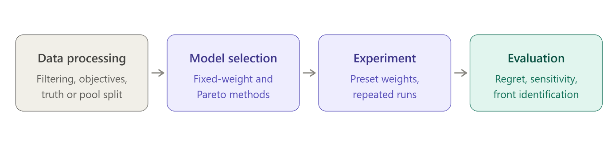
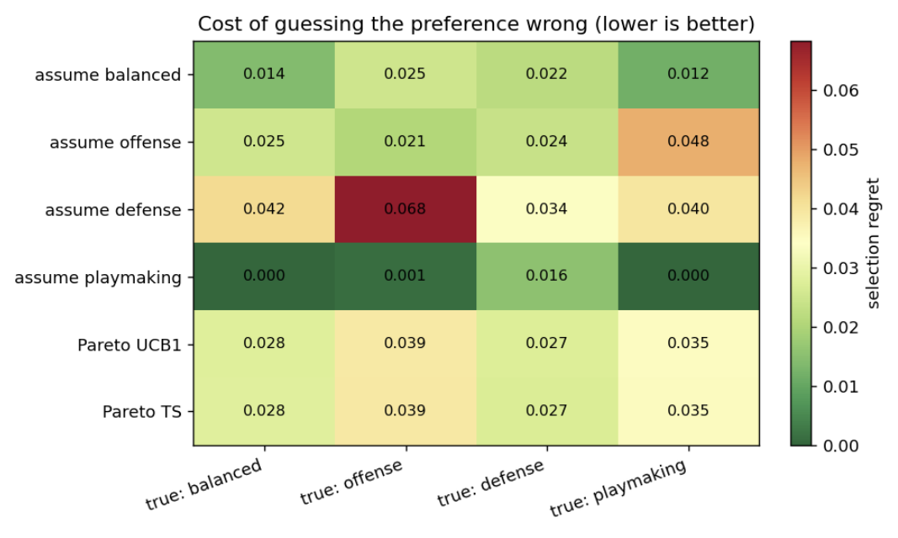

# Weight Sensitivity in Multi-Objective Bandits

Code for the paper **"Weight Sensitivity in Multi-Objective Bandits: Fixed-Weight vs. Pareto Methods for NBA Player Selection"** by Siyu Ren, accepted at the *2026 4th International Conference on Data Analysis and Machine Learning (DAML 2026)*, Kuala Lumpur, Malaysia (proceedings published by SciTePress).

## The question

Multi-armed bandit algorithms assume a scalar reward, but many selection problems have several competing objectives. Collapsing them into one score requires a weight fixed before any data arrives. This project measures **how much that choice costs**, and whether weight-free Pareto methods avoid the cost.

The testbed is NBA player selection with three objectives, all computed per game:

| Objective | Definition |
|---|---|
| Offense | True Shooting-style efficiency, `PTS / (2 * (FGA + 0.44 * FTA))` |
| Defense | (steals + blocks) per 36 minutes |
| Playmaking | assists per 36 minutes |

Each arm is a player: 286 players from the 2024-25 regular season with at least 40 games and 15 minutes per game. Pulling an arm draws one of that player's games.



## Method

- **No leakage.** Each player's games are randomly split in half. The true means and the reference Pareto front come only from one half; the bandits sample only from the other.
- **Trade-off verified, not assumed.** The three objectives are near-orthogonal (all pairwise |r| ≤ 0.101, none statistically significant), with 21 players on the Pareto front.
- **Fixed-Weight methods** scalarize the reward under one of four preset weights (balanced, offense-, defense-, playmaking-leaning) and commit to the single player they believe is best.
- **Pareto methods** (Pareto UCB1, Pareto Thompson Sampling) use no weight and return the set of players they identify as non-dominated.
- **Evaluation.** Every selection is scored against a grid of 36 candidate preferences on the weight simplex. The mean regret over the grid measures typical performance; its standard deviation measures **weight sensitivity**.
- **Setup.** 100,000 rounds per run, 30 independent runs. The number of runs was chosen from the convergence of the standard error (Figure 2): ten runs were not enough.

## Main results

| Method | Selection (30 runs) | Mean regret | Worst case | Sensitivity (SD) |
|---|---|---|---|---|
| Assume balanced | Nikola Jokić (21/30) | 0.0201 | 0.0401 | 0.0089 |
| Assume offense | Jaxson Hayes (28/30) | 0.0313 | 0.0719 | 0.0134 |
| Assume defense | Scotty Pippen Jr. (25/30) | 0.0478 | 0.0952 | 0.0176 |
| Assume playmaking | Nikola Jokić (30/30) | **0.0062** | **0.0393** | 0.0093 |
| Pareto UCB1 | 15 players on average | 0.0342 | 0.0537 | **0.0081** |
| Pareto TS | 16 players on average | 0.0343 | 0.0540 | 0.0082 |

- **The preset matters a lot.** Mean regret varies by a factor of **7.7** between the best and the worst preset.
- **Pareto methods are the most stable.** They are never the best performer, but they have the lowest weight sensitivity of all methods. A preset outperforms them when it matches the true preference and falls well behind when it does not.



### Robustness check: removing one player

Two presets converge on Jokić, so the experiment is repeated with him removed:

| Method | Full pool | Jokić removed |
|---|---|---|
| Assume balanced | 0.0201 | 0.0216 |
| Assume offense | 0.0313 | 0.0276 |
| Assume defense | 0.0478 | 0.0201 |
| Assume playmaking | 0.0062 | 0.0336 |
| Pareto UCB1 | 0.0342 | 0.0340 |
| Pareto TS | 0.0343 | 0.0345 |

The ranking reverses: the best preset becomes the worst, and the spread narrows from 7.7x to 1.7x. The Pareto methods shift by only 0.0002. **Weight sensitivity is a property of the candidate pool, not of the objectives**, so the decision maker cannot know in advance which preset is safe.

### Other analyses

- **Front stability.** Over 200 random splits, the front holds 10 to 31 players (mean 19.8, SD 4.0). Nikola Jokić and Victor Wembanyama are on the front in every split, and 16 players appear in at least half.
- **Pareto-set identification.** Against the 21-player reference front, Pareto UCB1 reaches F1 = 0.39 and Pareto TS reaches F1 = 0.40.

## Repository layout

```
mobandit/            core package
  config.py          every setting that affects the results
  data.py            loading, filtering, truth/pool split
  env.py             bandit environment (one arm per player)
  pareto.py          Pareto dominance (numba-compiled, NumPy fallback)
  algorithms.py      scalarized UCB / TS / ETC, Pareto UCB1, Pareto TS
  evaluation.py      F1 identification, selection regret, weight sensitivity
  plots.py           figures
scripts/
  feasibility.py     do the three objectives really conflict?
  correlations.py    correlations and Pareto front (Table 3, Figure 3)
  run_experiment.py  main experiment and robustness check (Tables 4-6, Figures 4-5)
  convergence.py     how many repetitions are enough (Figure 2)
  front_stability.py stability of the reference front across 200 splits
tests/               fast tests on a synthetic environment
figures/             figures from the paper
data/                put PlayerStatistics.csv here (see data/README.md)
```

## Reproducing

```bash
git clone https://github.com/EricRen060125/pareto-bandit-weight-sensitivity.git
cd pareto-bandit-weight-sensitivity
python -m venv .venv && source .venv/bin/activate    # Windows: .venv\Scripts\activate
pip install -e .
```

Download the data as described in [data/README.md](data/README.md), then:

```bash
python scripts/correlations.py    --csv data/PlayerStatistics.csv
python scripts/run_experiment.py  --csv data/PlayerStatistics.csv                    # main results
python scripts/run_experiment.py  --csv data/PlayerStatistics.csv \
       --exclude "Nikola Jokic" --out-prefix results30_noJokic                       # robustness check
python scripts/convergence.py     --csv data/PlayerStatistics.csv --runs 30
python scripts/front_stability.py --csv data/PlayerStatistics.csv --reps 200
python scripts/feasibility.py     --csv data/PlayerStatistics.csv                    # optional pre-check
```

Outputs (figures and CSV/JSON tables) go to `results/`. The tables above use scalarized UCB for the Fixed-Weight methods; add `--fw ts` or `--fw etc` to run them with Thompson Sampling or Explore-Then-Commit instead. A full run trains 6 methods × 100,000 rounds × 30 runs and needs numba for reasonable speed; for a quick check, add `--T 5000 --repeats 2`.

Tests (no data needed):

```bash
pip install pytest && pytest -q
```

## Citation

```
Siyu Ren. Weight Sensitivity in Multi-Objective Bandits: Fixed-Weight vs. Pareto
Methods for NBA Player Selection. In Proceedings of the 2026 4th International
Conference on Data Analysis and Machine Learning (DAML 2026). SciTePress, 2026.
```

## References

- M. M. Drugan and A. Nowé. Designing multi-objective multi-armed bandits algorithms: A study. *IJCNN*, 2013.
- S. Q. Yahyaa and B. Manderick. Thompson sampling for multi-objective multi-armed bandits problem. *ESANN*, 2015.
- E. A. Moore. NBA Dataset: Box Scores and Stats (1947 – Today). Kaggle, 2026.

## License

Code: MIT. Data: CC0 (see [data/README.md](data/README.md)).
